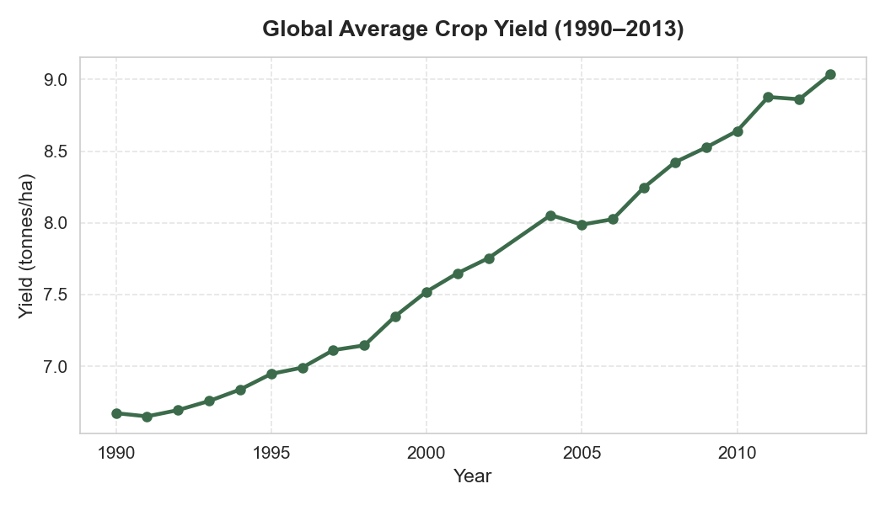
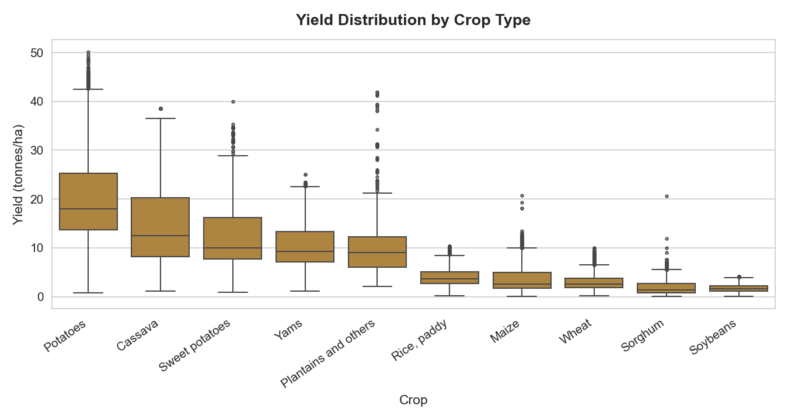
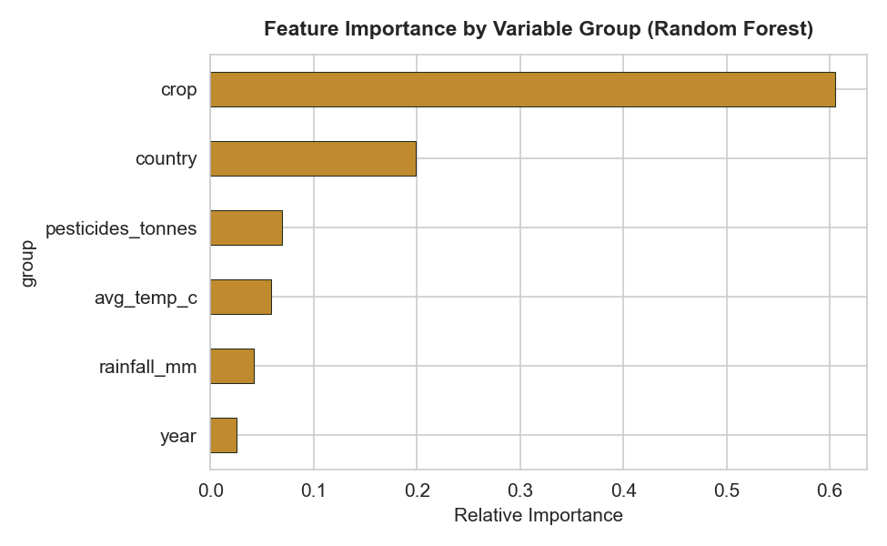
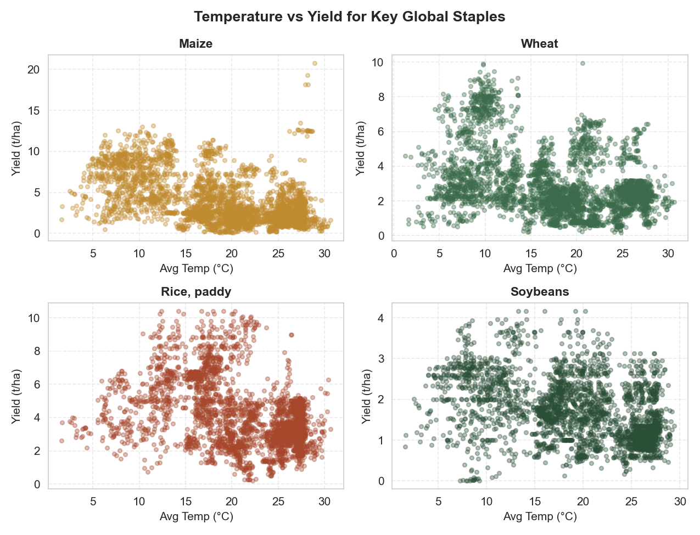

# Harvest & Heat — Crop Yield Prediction Under a Changing Climate

[](https://www.python.org/)
[](https://scikit-learn.org/)
[](https://www.chartjs.org/)
[](LICENSE)

An end-to-end data science and machine learning project examining **24 years (1990–2013)** of agricultural and meteorological records across **101 countries** and **10 staple crops**. The system evaluates how temperature anomalies, precipitation patterns, and pesticide inputs impact agricultural yields ($t/ha$), tests regression architectures against an unseen temporal holdout, and delivers a **zero-server, client-side interactive browser dashboard** driven by an exported Random Forest engine.

---

## 🌾 Highlights & Key Findings

1. **Top Predictive Architecture ($R^2 = 0.9527$):**
   - Evaluated on an out-of-time test set (trained on 1990–2009, tested on 2010–2013).
   - Random Forest achieved an **$R^2$ of 0.9527**, with an RMSE of **2.072 tonnes/ha** and MAE of **1.061 tonnes/ha**, significantly outperforming linear baselines (~0.72) and confirming heavy non-linear interactions between geography, climate, and crop varieties.

2. **The "Uncomfortable Finding" (Feature Importance):**
   - **Crop identity (~60.5%)** and **Country/Geography (~19.9%)** together account for over **80%** of yield variation.
   - Climate features (average temperature, annual precipitation, and pesticide applications) account for the remaining ~20%. Climate effects manifest incrementally within specific country-crop pairs over time.

3. **In-Browser Client-Side ML:**
   - A 25-tree Random Forest was exported directly to JSON node trees (`exports/forest_model.json`).
   - The web dashboard runs direct tree traversals in pure JavaScript with zero backend required—delivering instant, offline what-if yield scenario forecasting.

---

## 📊 Model Benchmark Results

Evaluated strictly on the **2010–2013 holdout** (years the models never saw during training):

| Rank | Model | $R^2$ Score | RMSE ($t/ha$) | MAE ($t/ha$) | Notes |
|:---:|:---|:---:|:---:|:---:|:---|
| 🥇 | **Random Forest Regressor** | **0.9527** | **2.072** | **1.061** | **Best overall (selected for production)** |
| 🥈 | **Gradient Boosting Regressor** | **0.8978** | **3.046** | **1.919** | Strong gradient ensemble |
| 🥉 | **Ridge Regression** | **0.7193** | **5.046** | **3.377** | Regularized linear baseline ($\alpha=1.0$) |
| 4 | **Linear Regression** | **0.7192** | **5.047** | **3.381** | Ordinary Least Squares |

---

## 📂 Project Architecture

```
diksha-project/
├── data/
│   └── yield_df.csv                    # Merged FAO & World Bank dataset (28,242 rows)
├── figures/                            # High-resolution publication figures
│   ├── yield_trend.png                 # Global historical yield trajectory
│   ├── yield_by_crop.png               # Yield distribution by crop family
│   ├── correlation_heatmap.png         # Feature cross-correlation matrix
│   ├── temp_vs_yield_by_crop.png       # Crop-specific temperature response facets
│   └── feature_importance.png          # Grouped variable relative importance
├── models/
│   └── best_model.joblib               # Full serialized production Random Forest pipeline
├── exports/
│   ├── forest_model.json               # Exported tree nodes for browser traversal
│   ├── dashboard_data.json             # Aggregated stats & chart datasets
│   └── model_comparison.csv            # Test set benchmark metrics
├── notebooks/
│   ├── crop_yield_pipeline.py          # Complete end-to-end Python pipeline
│   └── crop_yield_analysis.ipynb       # Interactive Jupyter Notebook with rich cells
├── dashboard_template.html             # Base HTML/CSS/JS template
├── index.html                          # Compiled, standalone interactive web dashboard
├── run_dashboard.py                    # Local HTTP server launcher with auto-browser opening
├── requirements.txt                    # Python package dependencies
└── README.md                           # Documentation & user guide
```

---

## 🚀 Quickstart Guide

### 1. Prerequisites & Environment Setup

Ensure Python 3.9+ is installed. Install the dependencies:

```bash
pip install -r requirements.txt
```

### 2. Run the Machine Learning Pipeline

To regenerate all figures, retrain models, export browser JSON, and compile `index.html`:

```bash
python crop_yield_pipeline.py
```
*(or run `python notebooks/crop_yield_pipeline.py`)*

### 3. Launch the Interactive Web Dashboard

You have two easy ways to interact with the dashboard:

#### Option A: Built-in local server (Recommended)
```bash
python run_dashboard.py
```
This automatically hosts the dashboard at `http://localhost:8080/index.html` and opens your default browser.

#### Option B: Standalone direct view
Simply double-click [`index.html`](file:///c:/Users/gurxs/OneDrive/Desktop/diksha-project/index.html) in your file explorer. It requires **zero backend** and works entirely offline in any modern browser!

### 4. Interactive Jupyter Notebook

Open and execute the step-by-step notebook:
```bash
jupyter notebook notebooks/crop_yield_analysis.ipynb
```

---

## 🖥️ Web Dashboard Features

The web dashboard (`index.html`) is built with **Fraunces & IBM Plex typography**, warm earthy climate-inspired styling, and interactive **Chart.js** visualizations:

- **Global Average Yield Sparkline:** Dynamic percentage increase tracking from 1990 to 2013.
- **Three Decades of Harvest:** Historical multi-year yield trajectory curve.
- **Crop Yield Distribution:** Comparative bar chart highlighting root crops vs grains with standard deviations.
- **Feature Importance Breakdown:** Visual breakdown of structural crop/country effects vs. environmental factors.
- **Crop-by-Crop Climate Scatters:** Multi-facet scatter plots for Maize, Wheat, Rice, and Soybeans against temperature variations.
- **Agricultural Leaders & Laggards:** Top 12 and bottom 12 national yield averages.
- **Model Comparison Table:** Live test metric table highlighting the winning Random Forest model.
- **Interactive "What-If" Predictor:**
  - Sliders for Crop, Country, Projected Year, Annual Rainfall (mm), Average Temperature (°C), and Pesticide Use (tonnes).
  - Instantaneous client-side Random Forest evaluation with visual baseline benchmark indicator.

---

## 📈 Visualizations Overview

| Figure | Description |
|:---|:---|
|  | **Global Yield Trajectory:** 1990–2013 steady climb driven by technological intensification. |
|  | **Yield Distribution:** Root crops (Potatoes, Cassava) yield significantly higher bulk weight per hectare. |
|  | **Feature Importance:** Crop and geographic structural variables lead predictive weight. |
|  | **Climate Response:** Crop-specific temperature response across global country-years. |

---

## 📜 Dataset Citation

- **Source:** Food and Agriculture Organization (FAO) & World Bank Open Data.
- **Compilation:** Kaggle Crop Yield Prediction Dataset (`patelris`).
- **Features:**
  - `country` (`Area`): Country name (101 nations).
  - `crop` (`Item`): 10 major global crops.
  - `year`: 1990 to 2013.
  - `yield_tons_ha`: Crop yield in metric tonnes per hectare.
  - `rainfall_mm`: Average annual precipitation.
  - `pesticides_tonnes`: Total national pesticide consumption.
  - `avg_temp_c`: Average surface temperature in Celsius.

---

## 🤝 Authors & Credits

Crafted for the **Crop Yield & Climate Data Science Project**. Built with Python, Pandas, Scikit-Learn, Matplotlib, Seaborn, and Chart.js.
